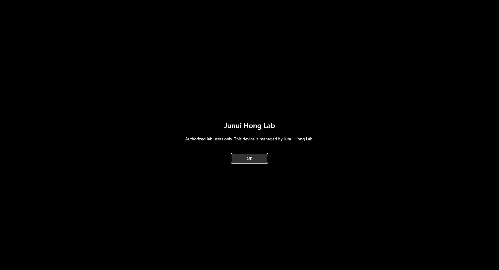
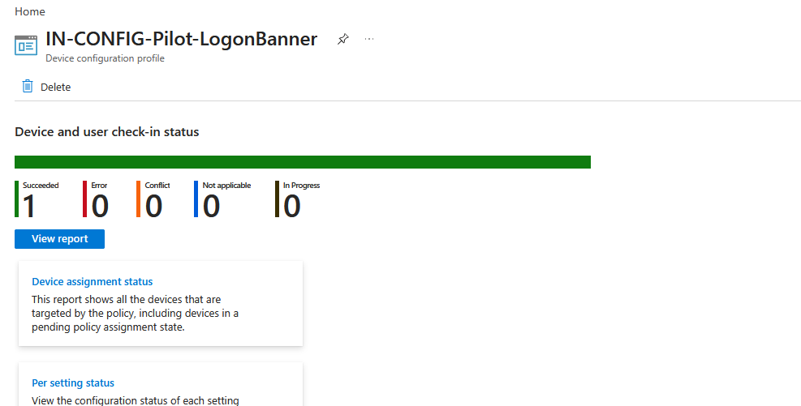

# IT Infrastructure Portfolio

A company lab connecting a fixed Packet Tracer network design with VMware networking, Active Directory, Microsoft Entra ID, Microsoft 365, and Intune.

I first worked on network infrastructure, AD administration, and Microsoft 365 as separate labs. This project brings those foundations into one company scenario and tests how addressing, identity, access, and device management work together.

**Current result — October 31, 2026:** Four department data networks were tested using one representative Windows client. The lab also completed joiner, mover, and leaver scenarios, synchronized identities with Connect Sync, and enrolled the hybrid-joined client in Intune. Jamie's compliance policy reported Compliant, and the login-banner profile reported Succeeded for one device.

## Documentation

| Document | Purpose |
|---|---|
| [How-to Guide](HowTo.md) | Repeatable setup and verification, with GUI steps for Windows administration |
| [Company Specification](company-spec.md) | Addressing, NIC mapping, workforce baseline, identity, and policy scope |
| [Integration Plan](integration-plan.md) | Acceptance results and remaining validation |
| [Problems and Resolutions](ProblemSolving.md) | Evidence, failed approaches, recovery, and unresolved causes |
| [October 31 Session Record](progress-2026-10-31.md) | Department networks, lifecycle tests, M365, hybrid join, and Intune |
| [October 30 Session Record](progress-2026-10-30.md) | Historical setup and Connect Sync rollout |
| [Evidence Index](resources/photos/readme.md) | Screenshots and the limits of each |
| [AD Resources](resources/AD/readme.md) | Baseline CSV and original scripts |
| [Network Resources](resources/Network/readme.md) | Fixed network source and implemented mappings |

Documentation and code comments are maintained in English. Windows configuration steps use the GUI where practical; terminal commands cover Ubuntu configuration and focused verification.

## Project foundations

| Foundation | Repository | Relationship to this integration |
|---|---|---|
| Network design | [Network Infrastructure Lab](https://github.com/junuiui/network-infrastructure-lab) | Fixed addressing/reference; original Packet Tracer files unchanged |
| AD administration | [Active Directory Homelab](https://github.com/junuiui/homelab) | Original environment preserved; integration uses the separate jh.test AD |
| Cloud administration | [M365, Entra & Intune Lab](https://github.com/junuiui/m365-entra-intune-lab) | Earlier cloud-only work retained; new workforce and hybrid client verified here |

## What was verified

| Area | Result | Evidence |
|---|---|---|
| Four department networks | DHCP, AD DNS, SMB, Internet connectivity, department GPOs, and share tests reported passed | Four active scopes captured; named test matrix in the session record |
| Department authorization | Own-share file operations allowed; tested cross-department shares denied | Access-denied screenshots and owner-reported test results |
| Workstation logon | Department GPOs applied as the representative PC moved between OUs | Logon-denied screenshot; department test reports |
| Joiner | Jamie created in AD, given HR access, synchronized, and signed in to the cloud | Owner report; later Jamie/Intune screenshots |
| Mover | Engineering-to-HR access change tested and restored | Owner report; test account name not captured |
| Leaver | Emma disabled in AD and Entra; new local and cloud sign-ins blocked | AD disabled-account screenshot and owner report |
| Microsoft 365 | Jamie assigned Business Premium and opened Outlook web | Owner report |
| Hybrid join | DomainJoined YES, AzureAdJoined YES, device authentication SUCCESS, PRT YES | Supplied diagnostic output |
| Intune enrollment | HR-PC-01 managed by Intune; primary user Jamie Morgan | Portal and successful client-sync screenshots |
| Compliance | WIN-COMP-HR-Pilot reported Compliant | Owner report after policy assignment |
| Configuration delivery | Login banner appeared and profile reported Succeeded: 1, Error/Conflict: 0 | Client and portal screenshots below |

Actual profile name: IN-CONFIG-Pilot-LogonBanner. It differs from the originally suggested WIN-CONFIG name; the documentation uses the deployed name.

## Baseline and current identities

The baseline CSV contains 70 synthetic employees: HR 8, Engineering 35, Sales-Marketing 22, IT 5.

Jamie Morgan was added separately as the joiner. Emma Wilson remains retained but disabled as the leaver. That produces 71 employee account objects and an expected 70 enabled employee accounts if no other accounts changed. The original CSV remains a baseline, not a current inventory export.

The October 30 screenshot of 72 directory objects is historical. A fresh final directory count was not supplied after Jamie's addition.

## Final operating state

- Windows client: HR-PC-01, Windows 11 Pro, HR/Computers OU, VMnet4, DHCP.
- Device join: AD domain joined and Microsoft Entra hybrid joined.
- Intune primary user: Jamie Morgan.
- MDM user scope: All, intentionally retained by the owner; WIP scope: None.
- Compliance pilot: SG-Intune-Pilot-Users, containing Jamie.
- Configuration pilot: SG-Intune-Pilot-Devices, containing HR-PC-01.
- Automatic Intune enrollment GPO: linked to HR/Computers.
- Emma: disabled; session revocation, group cleanup, and data handover are not verified.
- Cloud Sync: disabled; Connect Sync remains the working synchronization engine.

## Boundaries and remaining work

Packet Tracer and VMware share a company design; they are not physically connected. Separate VMnets represent department networks without claiming an implemented 802.1Q trunk. Voice, guest, Wi-Fi, printers, and the simulated web server remain Packet Tracer/design-only.

One client was moved between networks and computer OUs. This verifies sequential functional behavior, not simultaneous multi-client operation or 70-client capacity. Network ACL isolation between departments has not been implemented; share/logon denials are identity controls.

Remaining closeout:
- Reboot and verify all expanded router interfaces, forwarding, NAT, and DHCP Relay persistence together.
- Capture a final AD/Entra inventory, enabled counts, memberships, and license snapshot.
- Decide whether to finish Emma's session/group/data cleanup.
- Validate read-only resource groups if that access tier is needed.
- Optionally add app deployment, network ACLs, BitLocker/LAPS, or backup/restore tests.

The original Cloud Sync timeout and the initial missing-MDM-URL cause remain unresolved. Successful recovery is documented without claiming a proven root cause.
