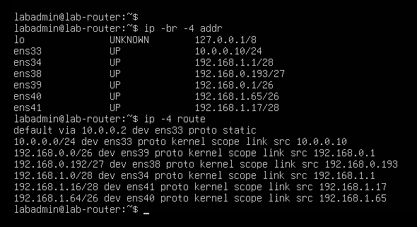
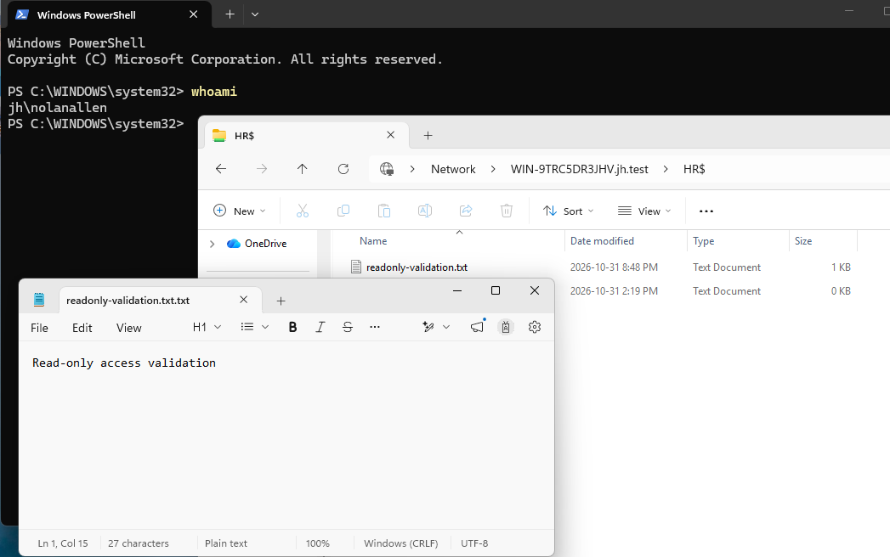
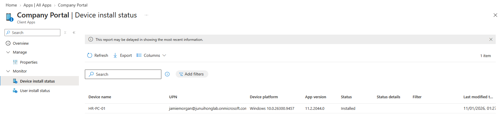

# IT Infrastructure Portfolio

A company lab connecting a fixed Packet Tracer network design with VMware networking, Active Directory, Microsoft Entra ID, Microsoft 365, and Intune.

- **Built:** four department networks, a new AD domain (`jh.test`) with 70 baseline employees, Microsoft Entra Connect Sync, and an Intune-managed hybrid-joined client, all from one company specification.
- **Verified:** joiner, mover, and leaver scenarios; department share and GPO access; hybrid join; Intune compliance, configuration profile, and app delivery.
- **Limits:** one client moved between networks (sequential, not simultaneous), network ACLs not yet implemented, and the original Cloud Sync timeout is unresolved.

I first worked on network infrastructure, AD administration, and Microsoft 365 as separate labs. This project brings those foundations into one company scenario and tests how addressing, identity, access, and device management work together.

**Status as of October 31, 2026.**

## Architecture

```
Packet Tracer design (fixed addressing and topology reference)
        |  same addressing design, not physically connected
        v
VMware implementation
  Router (six interfaces, NAT, DHCP relay)
    |-- Department networks: HR / Engineering / Sales-Marketing / IT
    '-- Windows Server: AD DS (jh.test), DNS, DHCP, department shares
  AD (jh.test) --Entra Connect Sync--> Microsoft Entra ID --> Intune / Microsoft 365
  HR-PC-01: AD domain joined + Entra hybrid joined, managed by Intune
```

## Documentation

| Document | Purpose |
|---|---|
| [How-to Guide](HowTo.md) | Repeatable setup and verification, with GUI steps for Windows administration |
| [Company Specification](company-spec.md) | Addressing, NIC mapping, workforce baseline, identity, and policy scope |
| [Integration Plan](integration-plan.md) | Acceptance results and remaining validation |
| [Problems and Resolutions](ProblemSolving.md) | Evidence, failed approaches, recovery, and unresolved causes |
| [October 31 Session Record](progress-2026-10-31.md) | Department networks, lifecycle tests, M365, hybrid join, and Intune |
| [October 30 Session Record](progress-2026-10-30.md) | Historical setup and Connect Sync rollout |
| [Evidence Index](resources/photos/readme.md) | Screenshots and the limits of each |
| [AD Resources](resources/AD/readme.md) | Baseline CSV and original scripts |
| [Network Resources](resources/Network/readme.md) | Fixed network source and implemented mappings |

Documentation and code comments are maintained in English. Windows configuration steps use the GUI where practical; terminal commands cover Ubuntu configuration and focused verification.

## Project foundations

| Foundation | Repository | Relationship to this integration |
|---|---|---|
| Network design | [Network Infrastructure Lab](https://github.com/junuiui/network-infrastructure-lab) | Fixed addressing/reference; original Packet Tracer files unchanged |
| AD administration | [Active Directory Homelab](https://github.com/junuiui/homelab) | Original environment preserved; integration uses the separate jh.test AD |
| Cloud administration | [M365, Entra & Intune Lab](https://github.com/junuiui/m365-entra-intune-lab) | Earlier cloud-only work retained; new workforce and hybrid client verified here |

## What was verified

| Area | Result | Evidence |
|---|---|---|
| Four department networks | DHCP, AD DNS, SMB, Internet connectivity, department GPOs, and share tests passed on one representative client | Four active DHCP scopes captured; test matrix in the October 31 session record |
| Department authorization | Own-share file operations allowed; tested cross-department shares denied | Access-denied screenshots |
| Read-only tier | Nolan could read HR data but not save changes, create, or delete; temporary access was revoked afterward | One read screenshot and three denied-operation screenshots; revocation: no screenshot captured |
| Restart persistence | Six router interfaces, forwarding, five NAT rules, and Relay survived restart; HR DHCP/DNS, connectivity, and hybrid state rechecked | Router and client screenshots; resource and Intune rechecks: no screenshot captured |
| Employee inventory | 71 employee objects: 70 enabled, one disabled (Emma) | ADUC Saved Query counts; inventory export not yet committed |
| Workstation logon | Department GPOs applied as the representative PC moved between OUs | Logon-denied screenshot; department test records |
| Joiner | Jamie created in AD, given HR access, synchronized, and signed in to the cloud | Later Jamie and Intune screenshots |
| Mover | Engineering-to-HR access change tested and restored | Session result; test account name and before/after state not captured |
| Leaver | Emma disabled in AD and Entra; new sign-ins blocked; HR access group removed; no assigned M365 license | Account and group screenshots; session revocation not yet confirmed |
| Microsoft 365 | Jamie assigned Business Premium and opened Outlook on the web | No screenshot captured |
| Hybrid join | DomainJoined YES, AzureAdJoined YES, device authentication SUCCESS, PRT YES | `dsregcmd` diagnostic output |
| Intune enrollment | HR-PC-01 managed by Intune; primary user Jamie Morgan | Portal and successful client-sync screenshots |
| Compliance | WIN-COMP-HR-Pilot reported Compliant | No screenshot captured |
| Configuration delivery | Login banner appeared; profile IN-CONFIG-Pilot-LogonBanner reported Succeeded: 1, Error/Conflict: 0 | Client and portal screenshots below |
| App delivery | Company Portal installed automatically, launched in the organization context, and reported Installed for HR-PC-01/Jamie | Installation notification, running app, and Intune device-install report |

Rows marked "No screenshot captured" are session-reported results without a saved screenshot. Some evidence was supplied in chat but is not committed to this repository; see the [Evidence Index](resources/photos/readme.md) for the available files.








## Cloud Sync vs Connect Sync

| | Cloud Sync | Connect Sync |
|---|---|---|
| Outcome | On-demand provisioning timed out; no successful pilot provisioning was verified | Identities synchronized; hybrid join and Intune enrollment worked on top of it |
| Status | Disabled; root cause not confirmed | Working synchronization engine |

Details of the Cloud Sync investigation are in [Problems and Resolutions](ProblemSolving.md).

## Baseline and current identities

The baseline CSV contains 70 synthetic employees: HR 8, Engineering 35, Sales-Marketing 22, IT 5.

Jamie Morgan was added separately as the joiner. Emma Wilson remains retained but disabled as the leaver. ADUC Saved Queries confirmed **71 employee objects: 70 enabled and one disabled, Emma**. The original CSV is a baseline, not a current inventory export.

The October 30 screenshot of 72 Entra directory objects is historical. The 71/70/1 counts are department-filtered AD employee counts, not a fresh total Entra count. A final inventory export has not been committed yet.

## Final operating state

- Windows client: HR-PC-01, Windows 11 Pro, HR/Computers OU, VMnet4, DHCP.
- Device join: AD domain joined and Microsoft Entra hybrid joined.
- Intune primary user: Jamie Morgan.
- MDM user scope: All, intentionally retained in this lab. Enrollment GPO links and compliance/configuration assignments remain separately scoped. WIP scope: None.
- Compliance pilot: SG-Intune-Pilot-Users, containing Jamie.
- Configuration pilot: SG-Intune-Pilot-Devices, containing HR-PC-01.
- Automatic Intune enrollment GPO: linked to HR/Computers.
- Emma: disabled, in HR/Users; GG_HR_Users removed and Domain Users retained; no assigned M365 licenses. Session revocation and data disposition are not yet confirmed.
- Cloud Sync: disabled; Connect Sync is the working synchronization engine.

## Boundaries

Packet Tracer and VMware share a company design; they are not physically connected. Separate VMnets represent department networks without claiming an implemented 802.1Q trunk. Voice, guest, Wi-Fi, printers, and the simulated web server remain Packet Tracer/design-only.

One client was moved between networks and computer OUs. This verifies sequential functional behavior, not simultaneous multi-client operation or 70-client capacity. Network ACL isolation between departments has not been implemented; share and logon denials are identity controls.

## Remaining work

- Capture missing screenshots (Compliant status, M365 license assignment).
- Confirm Emma's session revocation and any data-retention or hand-over requirements.
- Commit a reproducible inventory export (AD employee counts, group nesting, tenant and license inventory).
- Implement network ACLs: Packet Tracer ACL reference, then tested Ubuntu rules.
- BitLocker/LAPS, backup/restore, and the agreed additional network services.
