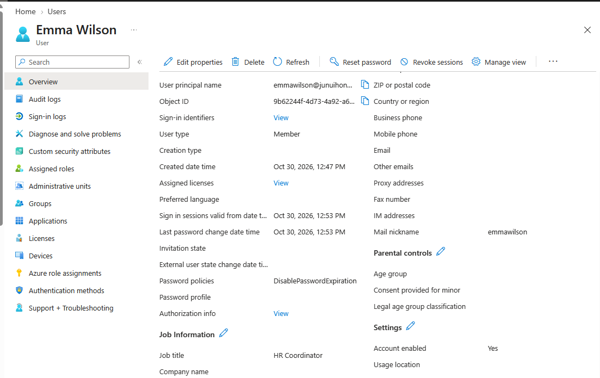
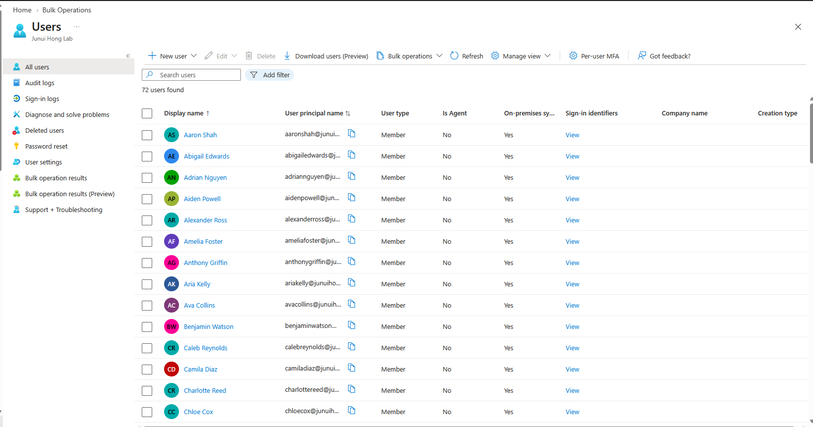

# Phase 1 — AD and Hybrid Identity

> Phase checkpoint. Pending items below describe the end of Phase 1, not the current state. See [Phase 2](phase-2.md) for client, network, lifecycle, M365 and Intune results, and [Phase 3](phase-3.md) for LAPS and BitLocker.

[README](README.md) · [How-to Guide](HowTo.md) · [Problems and Resolutions](ProblemSolving.md)

## Outcome

This phase established the company model and hybrid identity path. Connect Sync synchronized the 70-person AD workforce. Emma Wilson's cloud sign-in and job-title update were tested. Department resource groups and four file shares were configured; supplied output verifies the share and NTFS settings.

Client access testing continued in Phase 2. The replacement Windows 11 client needs reinstalling with a suitable image and a known local administrator.

## Evidence and status

| Work item | Status | Evidence / limit |
|---|---|---|
| Department workforce | Created | Owner reported 70 users; repository contains employee CSV |
| Employee UPN alignment | Completed report | Owner proceeded after the 70-user UPN check; full check output is not archived |
| Entra population | Screenshot verified | 72 active user objects; visible employee rows show on-premises sync |
| Synced employee filter | Completed report | Owner reported finishing the 70-user filter and export checks |
| Emma source identity | Screenshot verified | On-premises sync enabled = Yes, AD DN, SamAccountName, and domain shown |
| Emma cloud authentication | Success report | Owner signed in after setting a non-temporary AD password |
| Emma job-title propagation | Screenshot verified | HR Manager → HR Coordinator after AD change and Delta sync |
| Connect Sync scheduler | Enabled report | Owner reported completing the enable/verification instructions; final output is not archived |
| Department groups and nesting | Setup proceeded | Instructions were followed into share creation; direct membership/count output is not archived |
| Four SMB/NTFS configurations | Supplied output verified | Exact share permissions and folder ACLs are recorded below |
| Employee file access | Pending | No client read/write/denial results yet |
| GPO and workstation logon restriction | Pending | No integration-domain client test |
| Windows departmental DHCP / relay | Pending | Server network setup is not proof of departmental scopes |
| M365 / Intune for new employees | Pending | Existing cloud-only lab tests are separate |
| Cloud Sync | Unresolved | Timeout remained after reinstall |
| Router NAT persistence | Unverified | Save instructions were provided; reboot persistence result was not supplied |

The repository records owner-supplied screenshots, command output, and completion reports. It does not claim independent execution by the documentation author.

## Company and account alignment

- Workforce: HR 8, Engineering 35, Sales-Marketing 22, IT 5.
- Original Homelab AD preserved; the separate jh.test AD is used for integration.
- Account naming changed from a first-name prefix to lowercase firstnamelastname.
- CSV fields: FirstName, LastName, Department, PositionName.
- Alternate UPN suffix: junuihonglab.onmicrosoft.com.
- Emma was moved to Entra-Pilot while retaining Department = HR.
- Existing cloud-only test employees were removed by the owner's decision.
- Junui administrator, Emma, and Sales remained before full rollout.
- The later directory total is 70 employees + administrator + Sales object = 72.
- No transfer of old employees' mail, memberships, or device associations is claimed.

## Server network and DNS

The host physical LAN overlaps the fixed Packet Tracer server design. VMnet8 remains 10.0.0.0/24; VMnet3 provides an isolated 192.168.1.0/28 internal segment with no host adapter or VMware DHCP.

| Component | Address / role |
|---|---|
| DC | WIN-9TRC5DR3JHV.jh.test, 192.168.1.2/28 |
| DC gateway / DNS | 192.168.1.1 / 192.168.1.2 |
| Ubuntu internal NIC | ens34, 192.168.1.1/28 on VMnet3 |
| Ubuntu external NIC | ens33, 10.0.0.10/24 on VMnet8 |
| VMnet8 NAT gateway | 10.0.0.2 |
| DNS forwarders | 1.1.1.1, 8.8.8.8 |

Enabled IPv4 forwarding and MASQUERADE on the router. Verified DC-to-gateway Ping 4/4 and outbound TCP 443. Fixed the DC's previous external-DNS/dynamic-IP configuration; the owner reported a passing DNS test.

Full per-department virtual subnets, DHCP scopes, and relay are not complete.

## Cloud Sync investigation and tool change

Cloud Sync used a pilot-only scope, but on-demand provisioning repeatedly timed out and portal provisioning logs remained empty.

Actions included:
- Correcting initial on-demand input from ObjectGUID to the required user Distinguished Name.
- Fixing local AD DNS and validating basic outbound connectivity.
- Checking service state, WinHTTP proxy, endpoint names, and a ServiceBus HTTPS response.
- Restarting the agent after network changes.
- Installing diagnostic-tool prerequisites and collecting a verbose diagnostic trace.
- Identifying a request received via Relay, an ACK, and subsequent WebSocket connection failure after approximately 30 seconds.
- Creating the missing Endpoints folder with inherited service-account access.
- Confirming endpoints.txt was subsequently saved, without resolving the timeout.
- Removing and reinstalling the provisioning agent; the timeout persisted.

DLL-loading and performance-counter errors were observed, but their causal relationship to the timeout was not established. The double-NAT router was introduced after earlier failures, so double NAT alone is not a proven root cause.

Cloud Sync was disabled and its agent stopped for the Connect Sync comparison. Details are in [Problems and Resolutions](ProblemSolving.md#2-cloud-sync-on-demand-timeout-unresolved).

## Connect Sync and authentication

Installed Connect Sync with custom settings and Password Hash Synchronization. Tested Entra-Pilot first, then expanded to the four department OUs plus Entra-Pilot. Excluded unrelated built-in containers.

A bare Import-Module ADSync initially failed. Importing the installed module by its full path succeeded:

```powershell
Import-Module "C:\Program Files\Microsoft Azure AD Sync\Bin\ADSync\ADSync.psd1"
```

Emma initially had pwdLastSet = 0. Cleared the first-logon password-change requirement for this pilot only and reset the AD password. The owner then successfully signed in to the cloud.

Changed Title in AD to HR Coordinator, ran a Delta cycle, and observed the update in Entra.





The remaining 69 employees' passwords/sign-ins were not individually tested.

## Department group and share configuration

Intended group structure:

```text
Employee
  -> GG_<DEPARTMENT>_Users
  -> DL_<DEPARTMENT>_Share_Modify
  -> department folder permissions
```

Four Global Security Groups and eight Domain Local resource groups were specified. The owner progressed through creation/nesting, but did not supply the final membership-count output. Read-only groups are intended to be empty.

The following actual settings were supplied:

| Share | Folder | SMB permissions | NTFS permissions |
|---|---|---|---|
| HR$ | C:\LabShares\HR | Administrators Full; HR Modify group Change; HR Read group Read | SYSTEM/Admins Full; HR Modify M; HR Read RX |
| ENG$ | C:\LabShares\ENG | Administrators Full; ENG Modify group Change; ENG Read group Read | SYSTEM/Admins Full; ENG Modify M; ENG Read RX |
| SM$ | C:\LabShares\SM | Administrators Full; SM Modify group Change; SM Read group Read | SYSTEM/Admins Full; SM Modify M; SM Read RX |
| IT$ | C:\LabShares\IT | Administrators Full; IT Modify group Change; IT Read group Read | SYSTEM/Admins Full; IT Modify M; IT Read RX |

All four show FolderEnumerationMode = AccessBased and explicit inheritable folder ACLs. These are configuration checks, not successful user access tests.

No cross-department Deny ACE was added. Other departments are intended to have no access because they are not granted the relevant permissions. A trailing dollar sign hides browsing; it is not an authorization control.

## Client preparation blocker

The existing Win11-Intune VM:
- Is Entra joined: AzureAdJoined YES.
- Is not AD joined: DomainJoined NO.
- Was using the physical LAN with external/household DNS.
- Has an enabled local administrator account named Lab User, but its password is unknown.
- Still lists the deleted AlexKim identity among local administrators.
- Has no LAPS password available according to the owner.

No offline password bypass, device wipe, or Entra disconnection was performed. The existing Intune VM is retained.

A replacement VM named win-lab was attempted. The owner signed in with Emma during setup, then reported that the image was wrong and chose to reinstall. Its edition, join state, and domain readiness are unverified. Do not claim that it is AD joined or that HR share access has passed.

## Handoff to Phase 2

1. Verify Windows 11 Pro/Enterprise media and complete a fresh client installation.
2. Establish and securely record a working local administrator before any identity changes.
3. Verify edition, device join state, and the local account's administrator membership.
4. Connect the client to VMnet3 with an unused address such as 192.168.1.10/28, gateway .1, DNS .2.
5. Join jh.test and restart; sign in as JH\emmawilson.
6. Recheck GG/DL nesting and test HR file create/read/edit/delete.
7. Confirm ENG$, SM$, and IT$ return access denied for Emma.
8. Then configure GPO, workstation-specific logon restrictions, and joiner/mover/leaver tests.

The initial client is on the server segment for functionality testing. It is not a reproduction of the HR Data subnet.

## Shutdown and startup runbook

Instructions were provided; execution was not independently confirmed.

- Shutdown: Windows client → AD server → Ubuntu router.
- Ubuntu command: sudo shutdown -h now.
- Startup: Ubuntu router → AD server → client.
- After startup, verify forwarding/NAT persistence, DC DNS, and Connect Sync scheduler state.
- Snapshots were recommended as recovery points; their creation is not confirmed and they do not replace backups.
