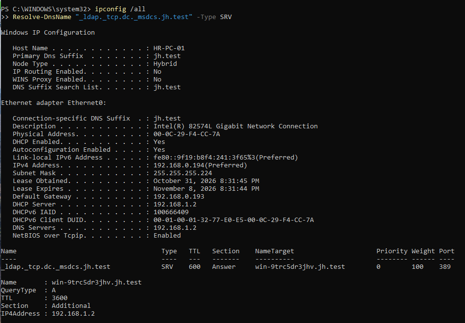

# Session Record — October 31, 2026

[README](README.md) · [How-to Guide](HowTo.md) · [Company Specification](company-spec.md) · [Evidence Index](resources/photos/readme.md)

## Outcome

Completed the working integration across four department data networks, AD authentication and resource access, employee lifecycle handling, Microsoft 365, hybrid device identity, Intune enrollment, compliance, and configuration delivery.

The representative client was restored to HR/Computers and VMnet4 after network tests. Jamie Morgan became the Intune primary user. The final login-banner profile reported Succeeded: 1, with no errors or conflicts.

## Initial health check and client installation

- Owner confirmed startup routing/NAT checks on the existing router.
- Supplied DC output showed outbound TCP 443 True, LDAP SRV lookup on port 389, and DC address 192.168.1.2.
- ADSync was Running; SyncCycleEnabled True; StagingModeEnabled False.
- Installed Windows 11 Pro. DISM reported Professional; the original client name was LAB-USER.
- Created local administrator LabAdmin through the work/school setup's Domain join instead path.
- Renamed/joined the device as HR-PC-01 in jh.test using GUI.
- Used temporary server-network addressing for initial join tests, then moved to departmental DHCP.
- Preserved the existing Entra-joined Intune VM. No wipe or disconnection of that earlier client was reported.

The ISO download page returned a request error. Installation later reached OOBE after an apparent interruption above 60%. The exact cause of the installation interruption was not established.

## Workstation policies and resource access

Created Computers child OUs under HR, Engineering, Sales-Marketing, and IT. Each department GPO defines Allow log on locally as Administrators plus the respective department Global group.

| Computer OU | GPO | Allowed employee group |
|---|---|---|
| HR/Computers | GPO-HR-Workstation-Logon | GG_HR_Users |
| Engineering/Computers | GPO-ENG-Workstation-Logon | GG_ENG_Users |
| Sales-Marketing/Computers | GPO-SM-Workstation-Logon | GG_SM_Users |
| IT/Computers | GPO-IT-Workstation-Logon | GG_IT_Users |

Security Filtering remained Authenticated Users. No domain-root/DC link or broad Deny log on locally policy was introduced.

Initial Emma tests showed HR share access and cross-department denial. A screenshot showed the expected sign-in-method-not-allowed result for the cross-department workstation test. Local LabAdmin access remained available; an initial credential error was fixed by using an explicit local account name.

The owner reported successful HR-to-Engineering computer OU movement, Engineering access, Emma denial, and HR restoration. Later tests covered the other department networks and GPOs.

## Employee lifecycle

### Mover

Temporarily moved an Engineering employee to HR:
1. Recorded original OU/group state.
2. Changed Department to HR.
3. Removed GG_ENG_Users and added GG_HR_Users.
4. Moved the user into HR/Users within the synchronization scope.
5. Tested HR workstation/file access and denial of the former Engineering share.
6. Restored the original department, groups, and OU.

Owner reported test and restoration passed. The mover's identity was not explicitly recorded; do not infer that it was Luke Fisher.

Department attributes and OU moves did not automatically manage groups. Membership was changed explicitly.

### Leaver — Emma Wilson

- Disabled Emma in AD.
- Screenshot showed Your account has been disabled at Windows sign-in.
- Ran synchronization; owner confirmed the Entra account became disabled.
- A private-browser cloud sign-in was blocked.
- Retained the account rather than deleting it or moving it out of sync scope.
- Revoke sessions was explained and recommended, but its execution was not confirmed.
- Later validation confirmed HR group removal and zero current M365 licenses. Data handover and existing-session termination are not verified.

The new ADUC screenshot shows Emma under HR/Users alongside Jamie. This supersedes her earlier Entra-Pilot location. Disabled state was independently confirmed through the query and sign-in tests.

### Joiner — Jamie Morgan

Created jamiemorgan in HR/Users:
- UPN: jamiemorgan@junuihonglab.onmicrosoft.com.
- Department: HR; Title: HR Assistant.
- Member of GG_HR_Users; Domain Users retained.
- Pilot password was entered securely; temporary-password requirement cleared for this cloud authentication test.
- AD client sign-in, HR file operations, and tested cross-department denials passed by owner report.
- Entra object synchronized with expected properties.
- Cloud My Account sign-in passed.

The baseline CSV remains unchanged at 70 entries. Jamie is additional and Emma retained disabled. Subsequent ADUC Saved Queries confirmed 71 employee objects / 70 enabled / one disabled. No final exported inventory file was committed.

## Four department data networks

Windows DHCP runs on the DC at 192.168.1.2. Ubuntu relays requests between each department and the server network.

| Role | VMnet | Ubuntu NIC | Router address |
|---|---|---|---|
| WAN | 8 | ens33 | 10.0.0.10/24, default gateway 10.0.0.2 |
| Server | 3 | ens34 | 192.168.1.1/28 |
| HR | 4 | ens38 | 192.168.0.193/27 |
| ENG | 5 | ens39 | 192.168.0.1/26 |
| SM | 6 | ens40 | 192.168.1.65/26 |
| IT | 7 | ens41 | 192.168.1.17/28 |

New NICs were matched by MAC rather than assumed order: VMnet5 ended :98, VMnet6 :A2, VMnet7 :AC.

All department VMnets have host adapters and VMware DHCP disabled. UFW was inactive and forwarding policy ACCEPT in the existing router setup. Internet traffic uses source-subnet MASQUERADE through ens33.

| Scope | Pool | Mask | Gateway |
|---|---|---|---|
| HR-Data | 192.168.0.194–219 | 255.255.255.224 | 192.168.0.193 |
| ENG-Data | 192.168.0.2–59 | 255.255.255.192 | 192.168.0.1 |
| SM-Data | 192.168.1.66–125 | 255.255.255.192 | 192.168.1.65 |
| IT-Data | 192.168.1.18–27 | 255.255.255.240 | 192.168.1.17 |

Every scope uses DNS 192.168.1.2 and suffix jh.test. A screenshot confirms four Active scopes.

Relay configuration:
```text
SERVERS="192.168.1.2"
INTERFACES="ens38 ens34 ens39 ens40 ens41"
OPTIONS=""
```

### Department network test matrix

One Windows client retained the name HR-PC-01 while its VMnet and computer OU were changed for each role.

| Role | Test employee | Verified/report outcome |
|---|---|---|
| HR | Ava Collins | DHCP/network checks, HR login/file operations, ENG denial; final HR restoration/login |
| ENG | Luke Fisher | Owner reported address/connectivity, GPO, own-share file operations and HR denial passed |
| SM | Nora Green | Owner reported address/connectivity, GPO, own-share file operations and HR/ENG denial passed |
| IT | Nolan Allen | Owner reported address/connectivity, GPO, own-share file operations and HR/ENG/SM denial passed |

The owner confirmed the instructed department lease checks. A later uploaded HR client image captures the exact post-restart lease 192.168.0.194/27. Exact ENG/SM/IT lease exports were not retained; their planned pools are not individual captured leases.

Network ACL segmentation was not tested: traffic routing is allowed; SMB and console authorization enforce the tested restrictions.

### Netplan and relay correction

ENG_NIC, SM_NIC, and IT_NIC placeholders were mistakenly saved as actual Netplan identifiers. Netplan accepted valid YAML, but the real ens39/40/41 devices stayed unconfigured; DHCP Relay also failed.

Replaced placeholders using the verified NIC mapping, applied the configuration, and restarted Relay. Owner confirmed active status, then successful department tests.

The later expanded-router restart check captured all six addresses, the single default route, forwarding 1, five retained NAT entries and active/enabled Relay. This closes the earlier persistence checkpoint.

## Microsoft 365

- Business Premium availability was reported as 24 before Jamie's assignment.
- Assigned Jamie Business Premium and checked the Intune service.
- Owner confirmed Outlook web inbox access.
- Later tenant status showed Microsoft Intune authority, Active account, 25 Intune licenses, and two licensed users at that moment.
- No claim of licensing all employees, verifying external mail flow, or deploying Office apps.

## Hybrid Microsoft Entra join

Configured Connect Sync device options/SCP for jh.test and confirmed HR/Computers in the synchronization scope.

Initial device registration passed through Pending, then owner reported DomainJoined YES, AzureAdJoined YES, and AzureAdPrt YES.

User/account errors during elevation were addressed with the known local administrator HR-PC-01/LabAdmin.

## Intune automatic enrollment

Final configuration:
- GPO-HR-Intune-AutoEnrollment linked to HR/Computers.
- Automatic MDM enrollment Enabled, User Credential.
- Effective policy values: AutoEnrollMDM = 1, UseAADCredentialType = 1.
- Microsoft Intune MDM authority, active tenant, and default enrollment URLs.
- MDM user scope All, intentionally retained by the owner; WIP scope None.
- Jamie licensed for Intune and a direct member of SG-Intune-Pilot-Users for the compliance pilot.

Final supplied device output confirmed:
- DomainJoined YES and AzureAdJoined YES.
- DeviceAuthStatus SUCCESS.
- Jamie AzureAdPrt YES.
- All three MDM discovery/service URLs populated.

Client Settings showed organizational management and a successful Intune sync. The portal then displayed HR-PC-01, primary user Jamie Morgan. User scope, enrollment GPO scope, compliance assignment and configuration assignment remain separate controls.

## Compliance

Initial device overview showed a Compliant badge but a failing aggregate policy status. Drilled into Default Device Compliance Policy:
- Is active: Compliant.
- Enrolled user exists: Compliant.
- Has a compliance policy assigned: Error 65001 (Not applicable).

The only previous custom policy was WIN-COMP-Sales-Bitlocker. Preserved it and created WIN-COMP-HR-Pilot:
- Windows 10 and later.
- Firewall, Antivirus, Real-time protection: Require.
- Remaining checks not configured.
- Default immediate noncompliance marking.
- Assigned SG-Intune-Pilot-Users.

Owner reported the new policy Compliant. No final per-setting screenshot was supplied. Do not claim the HR device's BitLocker status or that the old default-policy row was separately captured as cleared.

## Configuration delivery

Created device group SG-Intune-Pilot-Devices with HR-PC-01 and assigned a Settings catalog profile.

**Actual deployed name:** IN-CONFIG-Pilot-LogonBanner.

| Setting | Value |
|---|---|
| Interactive logon message title | Junui Hong Lab |
| Interactive logon message text | Authorized lab users only. This device is managed by Junui Hong Lab. |

The client displayed the banner after sync/restart. The portal initially showed all counts zero; the final screenshot showed Succeeded 1, Error 0, Conflict 0, Not applicable 0, In Progress 0.

This is a complete configuration-delivery test. The portal's final reporting delay is distinct from the earlier enrollment failure.

## Later checkpoint — restart, inventory and access cleanup

### Restart validation

Followed client → DC → router shutdown and router → DC → client startup. Uploaded evidence confirms:
- All six router NICs UP with intended addresses.
- Single default route through ens33 to 10.0.0.2.
- net.ipv4.ip_forward = 1.
- Five source-subnet MASQUERADE rules retained after restart.
- isc-dhcp-relay enabled and active, listening on the server and four department NICs.
- Four Windows DHCP scopes Active.
- HR-PC-01 DHCP enabled, address 192.168.0.194/27, gateway 192.168.0.193, DHCP/DNS 192.168.1.2.
- LDAP SRV lookup resolved the DC at 192.168.1.2 on port 389.
- Client SMB/HTTPS tests True.
- Jamie's final user-context check showed both joins YES, DeviceAuthStatus SUCCESS and AzureAdPrt YES.

HR resource checks and Intune Sync/check-in were reported healthy. No fresh complete DC health or ADSync scheduler transcript was supplied during this restart checkpoint.



### Employee inventory

Created ADUC Saved Queries by Department:
- Employee-Inventory: 71 objects.
- Employees-Enabled: 70.
- Employees-Disabled: one, Emma Wilson.

Filters were corrected for balanced parentheses and the owner confirmed all three results. These are AD employee counts, not total Entra objects or CSV rows. A repository copy of the inventory export is still pending.

The uploaded OU image shows both Emma and Jamie in HR/Users. The original 70-entry CSV is preserved.

### Emma access and license cleanup

Before/after user properties showed GG_HR_Users removed, retaining only Domain Users in the displayed direct membership list. Microsoft 365 showed Sign-in blocked and Licenses (0), with Business Premium 23/25 available.

Session revocation and Delta synchronization were instructed and acknowledged, but no explicit completion output or session-revocation audit was supplied. Retain this distinction instead of claiming every session was terminated. Zero current licenses does not prove the absence of historical mailbox or OneDrive data.

### HR read-only acceptance — Nolan Allen

Prepared a nonempty HR test file as Jamie. Actual Global group name was GG-HR-ReadOnly_Test. The test procedure used:
```text
Nolan -> GG-HR-ReadOnly_Test -> DL_HR_Share_Read -> HR$ Read / NTFS RX
```

Nolan retained IT membership. The computer was temporarily moved to IT/Computers for his console-login policy while the NIC stayed on HR VMnet4. This separated workstation-logon eligibility from resource authorization.

Supplied screenshots show:
- whoami = jh\\nolanallen and successful file read.
- Saving changes to the original shared file denied.
- New-item creation denied.
- Deletion of an existing shared file denied.

An initial direct DL membership was corrected through the GUI procedure. The final nested membership screen was not retained, so screenshots establish effective access outcomes rather than a complete group export.

Cleanup removed the temporary Global-to-DL link and Nolan's test-group membership, with HR access denial requested for verification. The owner subsequently reported no problem after the cleanup/restoration checks. HR-PC-01 returned to HR/Computers, VMnet4, with Jamie. No final membership export was supplied.

## Company Portal — next action, not yet verified

Provided the deployment runbook:
- Reuse the existing Company Portal app if its type is Microsoft Store app (new); otherwise add the Microsoft Corporation listing.
- Install behavior System.
- Required assignment to SG-Intune-Pilot-Devices; preserve existing Sales assignments.
- Sync HR-PC-01 and wait for Intune-driven installation.
- Verify Windows launch with Jamie and Device install status Installed.

The owner requested documentation before providing assignment/install results. Company Portal is therefore pending, not marked deployed or installed.

## Final state and remaining checks

| Item | Current checkpoint |
|---|---|
| Client | HR-PC-01, HR/Computers, VMnet4; Jamie restored by owner report |
| HR DHCP lease | 192.168.0.194/27; gateway 192.168.0.193; DHCP/DNS 192.168.1.2 |
| Router persistence | Six NICs, route, forwarding, five NAT rules and automatic Relay verified after restart |
| Employee inventory | 71 objects / 70 enabled / one disabled |
| Emma | Disabled, HR/Users, HR group removed, Domain Users retained, no M365 license |
| Intune | Jamie primary user; enrollment and management healthy by report |
| Compliance/configuration | HR policy Compliant reported; login-banner device and portal success captured |
| HR Read tier | Read allowed; save/create/delete denied; cleanup/restoration reported |
| Company Portal | Deployment instructions issued; installation and portal success pending |
| MDM / WIP scope | All / None, intentionally retained |
| Cloud Sync | Disabled; original cause unresolved |
| Connect Sync | Working identity/device sync path |

Remaining:
- Complete Company Portal assignment/install/launch/Installed evidence.
- Archive current inventory and final group/scheduler/tenant evidence.
- Confirm Emma session-revocation execution and retained-data decisions.
- Continue the agreed ACL, BitLocker/LAPS, backup/restore and additional network stages.

See [Evidence Index](resources/photos/readme.md). Current evidence includes the owner's five new network/OU/client screenshots and the read-only test captures.
